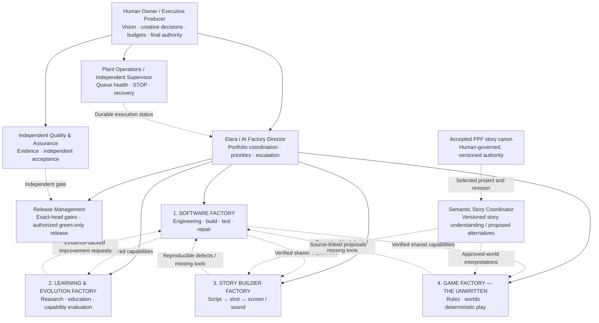
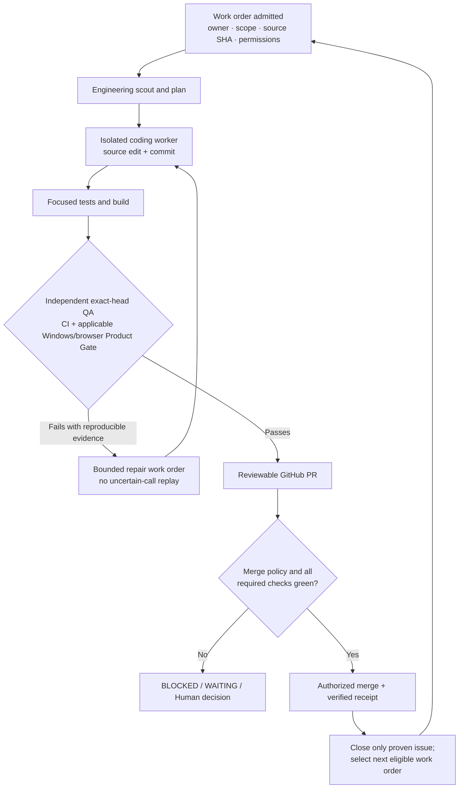

# PlotPickle Organization Chart

**An understandable operating model for four interconnected Factories**  
**Owner-approved direction:** October 27, 2026  
**Document type:** Organizational design and operating guide; roles described here are **functional assignments and target capabilities**, not a claim that independent agents, unattended jobs, or four factories are already running.  
**Governing sources:** [README.md](README.md) · [AGENTS.md](AGENTS.md) · [master roadmap #3274](https://github.com/BryanHarrisScripts/PlotPickle/issues/3274)

> **In one sentence:** The Human defines the purpose and retains meaningful authority; the **Software Factory** builds and repairs the shared machinery; **Learning & Evolution** finds and evaluates better methods; **Story Builder** turns approved stories into reviewable film and sound; and **Game — STORY: The Unwritten** turns approved worlds and rules into playable experiences. Independent verification, explicit permissions, a durable work ledger, and the Semantic Story Coordinator connect them.

This document explains PlotPickle through a familiar **company / factory organization chart**, then follows real work from management to the workshop floor and back. It is a **responsibility map**, not a new scheduler, agent runtime, project database, canon store, or authority layer. A role can initially be performed by a Human, one constrained AI session, an approved local worker, or a deterministic service. **Different job titles do not automatically imply different processes or independent verifiers.**

## 1. The organization at a glance

**How to read it:** Organizational *reporting* flows down. The *software platform* is a common foundation used by all three domain factories; it is **not** the owner of their content, rights, educational decisions, games' legal moves, or the Human's story canon. Learning, Story Builder and Game remain distinct peer responsibilities beneath the Director. The Semantic Story Coordinator spans creative activities **without becoming a fifth Factory**. Independent QA and STOP oversight have an escalation route that bypasses the implementer.

### Translate the factory language

| Traditional organization | PlotPickle equivalent | What it actually handles |
| --- | --- | --- |
| Owner / board | Human Owner / Executive Producer | Purpose, acceptable risk, creative approval, authority, budget, rights |
| General manager | Elara / AI Factory Director | Roadmap, departmental handoffs, exceptions, truthful portfolio report |
| Production planning | Engineering Manager + authorized dispatcher | Eligible issue selection, sequencing, bounded work orders, dependencies |
| Engineering workshop | Software Factory workers | Isolated patches, tests, builds, source commits |
| Research and development | Learning & Evolution | OSS Radar and craft research, experiments, learning proposals |
| Film studio | Story Builder | Screenplay breakdown, directing, storyboard, motion, editing and sound |
| Game studio | Game Factory | World and rule authoring, deterministic game engine, game playtests |
| Quality control lab | Independent QA / Product Gate | Challenges claims using exact-source tests, Windows/browser/product evidence |
| Shipping department | Release Management | Reviewable PR, required checks, authorized merge and release record |
| Plant maintenance / control room | Independent Windows Supervisor | Owned process, queue continuity, STOP, incident and recovery status |
| Creative continuity desk | Semantic Story Coordinator | Source-linked character, causality, filmability and continuity proposals |
| Records and traceability | Shared governed evidence ledger | What was requested, admitted, executed, verified, approved or blocked |

## 2. Who is accountable for what?

### Human Owner / Executive Producer

**Accountable for:** Vision, product priorities, acceptable scope and expense, Human creative/canon decisions, adaptation/performer/media permissions, and exceptional operating authorizations.

**Typical decisions:** Admit a major initiative, approve an AI/provider spending envelope, accept a story branch or asset, authorize distribution, delegate a bounded green-only merge policy, or intentionally STOP operations.

**Not delegated by implication:** A research finding does not authorize an installation; a successful game session does not change a screenplay; a passing CI check does not grant adaptation rights. The Owner should not have to perform routine dispatch once verified and bounded authority has been delegated.

### Factory Director — Elara (portfolio coordination)

**Accountable for:** Explaining the roadmap, reconciling cross-factory demand, ensuring an accountable owner for each work order, observing evidence, and escalating genuine exceptions instead of asking the Human to babysit every normal step.

**Produces:** Priority / dependency decisions within an approved roadmap, handoff records, status summaries, and proposed scope or policy changes for Human review.

**Limits:** A ChatGPT conversation does **not** run perpetually simply because it has a Director title. Durable unattended execution requires a *separately proven* Windows worker, approved provider route, authenticated transport, storage and explicit delegation. The Director cannot mint credentials, manufacture PASS evidence, override STOP or self-approve a merger or story lock.

### Factory 1 — Software Factory (the foundation)

**Mission:** Build, test, repair and evolve the common PlotPickle platform for all other factories. Parent [#3110](https://github.com/BryanHarrisScripts/PlotPickle/issues/3110); queue/dispatcher [#3142](https://github.com/BryanHarrisScripts/PlotPickle/issues/3142); backlog [#3148](https://github.com/BryanHarrisScripts/PlotPickle/issues/3148).

| Function / role | Work on the factory floor | Evidence / output |
| --- | --- | --- |
| Engineering Manager | Converts priorities into bounded, reproducible issues; checks dependencies, scope, owner and admission | Eligible work order and acceptance criteria |
| Architect / Scout | Reviews source ownership, existing contracts, affected integrations; avoids duplicate systems | Source-linked plan and risk assessment |
| Coding Worker | Executes *one authorized job* through an approved ChatGPT-mediated or local provider route in an isolated worktree | Scoped diff, commit, model/worker attempt receipt |
| Build and Test Engineer | Runs focused regressions, architecture checks and relevant build contracts; repairs on bounded evidence | Actual command results, versions, exact source SHA |
| Integration Engineer | Checks application, plugins, MCP, providers, persistence and affected surfaces | Reproducible integration outcomes and rollback plan |
| Engineering Reviewer | Inspects necessity, security, scope, regressions and maintainability without substituting opinion for tests | Review / requested changes |
| Dispatcher | Starts the *next eligible and authorized* job after completion and durable state reconciliation | Lease, job ID, start/stop state, no-replay receipt |

The Software Factory can fix a broken storyboard, add a vetted camera-planning capability, improve the game engine or repair OSS Radar—but **software ownership does not equal editorial or creative authority**.

### Factory 2 — Learning & Evolution Factory (R&D and education)

**Mission:** Improve what Humans and PlotPickle agents know, teach and can do, based on verifiable evidence. Owner [#3227](https://github.com/BryanHarrisScripts/PlotPickle/issues/3227). Reuse [OSS Radar](.github/workflows/oss-radar.yml) and the [creative-focus companion](docs/developer-briefs/oss-radar-creative-top-three.md), not another competing research scheduler.

| Function / role | Responsibility | Deliverable |
| --- | --- | --- |
| Research Director | Prioritizes capability gaps and source quality | Research brief / review queue |
| OSS Radar Analyst | Screens OSS candidates, provenance, compatibility, licensing, freshness and practical fit | Sourced candidate with uncertainty |
| Film & Craft Researcher | Studies screenplay craft, blocking, lighting, directing, sound, camera and Hollywood vocabulary | Copyright-safe references and craft comparisons |
| Instructional Designer | Prepares proposed lessons, exercises, glossaries and contextual guidance | Human-reviewable educational draft and measurable learning outcomes |
| Skills / Capability Evaluator | Evaluates agent references, provider options and teaching effectiveness | Baseline vs candidate evidence; adoption recommendation |

**Allowed:** Discover, compare, test assumptions in approved sandboxes and propose.  
**Not automatically allowed:** Install third-party code, silently change published lessons/Skills, claim model-weight self-training, execute unreviewed packages, spend outside permission, or merge. Approved *software changes* become Software Factory work orders.

### Factory 3 — Story Builder Factory (film studio)

**Mission:** Convert **approved narrative intent** into inspectable screen and sound production; see [Brotherly Love #3004](https://github.com/BryanHarrisScripts/PlotPickle/issues/3004) and the [README](README.md). Production grows through **Outline → Storyboard → Previs → Timeline**, with script writing, project references and the existing workspace capabilities preserved.

| Function / role | Responsibility | Reviewable result |
| --- | --- | --- |
| Production Director | Coordinates authorized film deliverables and shot/asset budgets | Approved production work order |
| Screenplay / Breakdown Specialist | Maps scenes, beats, characters, locations, props and production colors to source addresses | Source-linked breakdown |
| Director / Cinematography Planner | Specifies performances, camera, framing, blocking, lens intent and lighting | Shot list / directorial intent |
| Character & World Identity Steward | Protects persistent visual, voice and location identity independent of renderer/provider | Versioned reference contract and provenance |
| Storyboard / Previs Artist | Produces reviewable stills and shot timing before motion | Candidate boards and flipbook/Previs evidence |
| Motion / Rendering Specialist | Invokes only approved model/provider plans, costs and rights | Clips/keyframes, source and provider receipts |
| Sound / Dialogue Specialist | Works on narration, foley, music, performance and synchronization | Reviewable stems/assets and permission records |
| Editor / Finishing Specialist | Assembles shots, audio, timecode, interchange/FFmpeg exports | Editable timeline and playable candidate rough cut |

**Production work is staged:** Source/script and rights check → director plan → references → shots → storyboard → motion/audio → timeline → independent inspection → Human review → explicit Save/Lock. A booked rendering slot or a generated preview is **not** proof that a film is finished. A screenplay such as *Star Wars* is only a possible reference to production complexity; rendering or distributing an adaptation requires relevant rights. Prove the process first on original or appropriately licensed material and a limited 25-shot mini-block.

### Factory 4 — Game Factory: STORY: The Unwritten (game studio)

**Mission:** Turn approved Story Pieces, worlds and rules into playable, replayable experiences. Owner [#1675](https://github.com/BryanHarrisScripts/PlotPickle/issues/1675).

| Function / role | Responsibility | Evidence |
| --- | --- | --- |
| Game Director / Producer | Defines creator objective, staged playable slice and permissions | Approved game brief |
| World / Story Piece Designer | Defines content, locations, characters and legal reuse of story materials | Versioned world/Story Piece references |
| Rules / Engine Engineer | Implements deterministic action-validation and consequence resolution | Rules contracts and replayable tests |
| Game Validator | Independently tests legal/illegal actions, costs, hidden knowledge and world consistency | Deterministic results and failure findings |
| Bounded Character AI Designer | Adds optional expressive AI behavior constrained by the legal rules kernel | Scope/knowledge tests and character proposals |
| Playtest / UX Engineer | Exercises actual creator and player routes, save/reload and accessibility | Replay and Human playtest evidence |

**Game engine authority:** The deterministic STORY kernel—not an LLM—decides the legal move, cost, consequence and session state. A player's legal action is not permission to rewrite world rules; a creator's accepted world change is not permission to alter accepted PPF screenplay canon. **Wyrmwood** stays the teaching game and **BUZZ** the community/discovery connection.

### Shared coordinator and oversight (not additional factories)

**Semantic Story Coordinator — #3203:** Reads an explicitly selected, versioned PPF story and proposes explanations or alternatives about character motivation, causality, theme, continuity, filmability and downstream production. It **does not** accept its own proposal, mutate accepted canon, authorize render expenses or promote a game outcome to screenplay truth.

**Independent QA / Product Gate:** Reports assurance results separately from the worker that generated the candidate. Uses exact commit, relevant deterministic tests, Windows and browser/application acceptance, and when applicable media/playback, accessibility, game replay, rights or provider evidence. A synthetic success or model's confidence is not independent acceptance.

**Release Manager:** Maintains PR state, source and test SHA, required gates, authorized release policy, and merge/rollback traceability. **Only a green and explicitly permitted exact-head PR may merge.** For story output, release approval is separate from Git merging.

**Plant Operations / Independent Supervisor:** Owns durable machine/worker/process observations, queue status, restart/no-replay discipline, meaningful STOP and escalation. It must report missing provider/host capacity as blocked/offline; an application heartbeat alone does not prove engineering execution. The Supervisor must be able to expose and enforce STOP independently of the worker.

**Security, Rights & Provenance:** Cross-cutting controls, not fifth/sixth factories. Apply the correct permission and evidence gate in every domain.

## 3. The Software Factory production line — how an issue actually ships

The Software Factory is the **production machinery** for the whole company. The organizational titles map to a concrete, checkable sequence:

**Step-by-step work order:**  
1. **Intake:** A reproducible GitHub issue or a review-approved learning/story/game improvement is recorded. Define expected behavior, safe changed paths, affected surface, explicit provider/compute budget, and independent success evidence.
2. **Admit:** A durable dispatcher selects only eligible work. Bind the source/base SHA, grant, worktree and attempt identity. Reject stale, already-started or uncertain replayable claims.
3. **Investigate and build:** The architect/scout inspects existing ownership; the coding worker produces a bounded change **in isolation**, not on MAIN. A source diff, commit and write-once outcome are the production artifact—not an LLM's assertion.
4. **Test and repair:** Run focused unit/contract tests and required production builds. Failures become bounded repairs with explicit evidence; do not erase failed attempts.
5. **Independent challenge:** Another responsible verifier tests the *actual exact commit*, independent CI and applicable real Windows/browser operation. Failed acceptance returns a reproducible issue, not a manufactured PASS.
6. **Review and ship:** Create a reviewable PR and reconcile required PR/Product Gates. Merge *only* under existing owner-granted green-only authority for the current head; do not substitute old-head checks.
7. **Confirm and continue:** Record the actual merged SHA, issue closure evidence and next job's eligibility. STOP, expired grants, lost agent/host/provider capacity, or spent budget must remain visible and block work safely.

### The first two-cycle Factory acceptance

A working coding worker is **necessary but not sufficient**. The initial organizational acceptance is:

- **Cycle A:** Admit genuine issue A → real scoped code change → source tests/build → independent exact-SHA product/CI acceptance → reviewable PR → authorized merge → immutable outcome.
- **Automatic handoff:** Without another Human prompt or manual redispatch, the *same durable owned queue* reconciles A, respects STOP and starts eligible issue B; it does not retry uncertain A jobs.
- **Cycle B:** A second genuinely different issue repeats the full workflow, independently verifies, and merges under policy.
- **Observable controls:** Chat / PlotPickle GUI / CMD all show the same authenticated, durable job state and safe evidence references; a restarted worker can recover without inventing or replaying work.

**Passing two mocked tests is not this acceptance.** If a model cannot be invoked, CI is absent, the PC is asleep, Windows verification is unavailable, or merge authority is missing, report the actual BLOCKED/WAITING/OFFLINE state and preserve receipts.

## 4. The connections between departments

Each domain owns its deliverable, but **all code and platform integrations move through the Software Factory**.

| Origin | Trigger | What crosses the factory boundary | Receiving department | What must *not* happen |
| --- | --- | --- | --- | --- |
| Learning → Software | OSS Radar finds a vetted storyboard or render technique | Evidence, license/provenance, expected capability, baseline, risks and test plan | Software Engineering | Auto-install a package or call research an implementation |
| Software → Story Builder | New shot/camera feature independently passes acceptance | Versioned capability, documented API, tests, compatibility limits | Story Production | Treat a green code check as approved film footage |
| Story Builder → Learning | Director discovers inconsistent camera/blocking guidance | Example issue, source shot, craft question, rights-safe references | Research / Education | Silently rewrite lessons or canonical story |
| Story Builder → Software | Timeline loses an approved asset on reload | Sanitized steps, exact version, expected vs actual, reproducible proof | Engineering Intake | Leak private screenplay/media in public issue |
| Game → Software | Deterministic replay fails after reload | Rule-version, input sequence, safe fixture, exact mismatch | Engineering / Game Engine | Let an LLM declare a move legal to hide the defect |
| Story ↔ Game | Owner wants a playable interpretation of a film world | Rights-cleared, versioned references and *separate* creator/game authority | Game / Story Coordination | Automatically turn game choices into accepted PPF canon |
| Semantic Coordinator → Story | Source-backed continuity or filmability proposal | PPF project/revision, affected scene/shot, alternatives | Human creative review / Story Builder | Auto-accept a rewrite, Save or Lock |
| Any factory → QA / Operations | Work claims completion, becomes blocked or must stop | Exact artifacts, hashes, receipts, cost/permissions and failure status | Independent verifier / Supervisor | Certify itself or override intentional STOP |

**Illustrative complete loop:** An OSS Radar researcher identifies a camera-planning method → Human accepts a bounded proposal → Software implements it with tests → independent QA accepts the exact version → Story Builder uses it for **Brotherly Love** mini-block shot planning → the Human reviews the actual generated frames → a reproducible lighting/identity defect returns to Software or a craft-learning question returns to Learning. The next attempt begins with more capability and stronger evidence, **not** new automatic creative authority.

## 5. Decision rights: who can say “yes”?

| Decision | Responsible preparation | Required authority / gate |
| --- | --- | --- |
| Choose an eligible engineering issue within an approved batch | Dispatcher / Engineering Manager | Existing owner delegation, scope, budget, STOP/no-replay policy |
| Make an isolated source edit | Authorized coding worker | Exact-source write-once grant / bounded worker permissions |
| Accept technical correctness and real Product Gate | Independent QA | Actual tests, CI, relevant owner Windows/browser evidence; same head |
| Merge a GitHub PR | Release Manager | Owner's explicit green-only merge delegation **and** every applicable independent gate |
| Publish or change a lesson/Skill | Learning & Evolution | Human content/adoption approval and any software verification required |
| Approve and spend on media synthesis | Story Builder | Explicit provider, cost, privacy/rights and project scope permission |
| Accept a screenplay/character/world canon revision | Human author / PPF authority | Explicit accept/save/lock; correctly selected project and revision |
| Author or publish changed game-world rules | Game creator / Game Validator | Creator approval, deterministic validations and sharing rights |
| Resolve a player's move | Deterministic STORY engine | Already accepted rules, legal move, applicable player authority |
| Pause, STOP, revoke or recover | Owner / Independent Supervisor | Authenticated STOP, owned-process proof, protected immutable receipts |

**Independence is real separation of duty, not changing a role label.** A coding worker cannot mint the verifier's evidence. A supervisor's green heartbeat cannot forge Product Gate. A film artist cannot independently declare rights cleared.

## 6. A common work-order / handoff record

The exact wire format remains owned by existing PlotPickle contracts. This is a **conceptual checklist, not an implemented API schema**. A credible cross-factory handoff answers all of these questions:

| Field | Meaning |
| --- | --- |
| Work order and owning Factory | Issue / task ID, originating role, receiving role and accountable Human owner |
| Source identity | GitHub repository, exact source commit, or selected PPF project/revision/scene/shot; never silently substitute |
| Desired outcome | What working result or creative decision is actually requested |
| Scope and permissions | Allowed paths, tools, providers, data and cost; separate approval boundaries |
| Input provenance | Citations, licenses, provider/source history, sanitized reproduction and baseline |
| Execution and evidence | Attempt ID, actual changed files/assets, test/CI links, saved/read-back bytes or game replay |
| Independent acceptance | Named verifier and exact source/head or media revision; PASS/FAIL/UNPROVEN |
| Next action | Review, bounded repair, owner decision, authorized merge or genuinely eligible next job |
| Recovery and STOP | Irreversible effects, replay prohibition, resource owner and protected receipts |

Reports should distinguish **BELIEVED → PROPOSED → EXECUTED → INDEPENDENTLY VERIFIED**. Those are evidence classes, not automatic promotions. Operational **WORKING, WAITING, FIXING, BLOCKED, READY, MERGED** apply to the repository's existing [Development Run ledger contract](AGENTS.md); do not invent “completed” from a missing agent, stale heartbeat or absent Windows proof.

## 7. What a Human actually sees

The aim is a **simple experience outside, specialist departments inside**:

- **Portfolio view:** Four Factory lanes, responsible role, current priority, next milestone, blocked exceptions, approvals/spend requiring attention, evidence links.
- **Software Factory view:** Source/base/head, assigned issue/attempt, scope, worker availability, build/tests, PR/Product Gate, merge eligibility, STOP and next queued issue.
- **Learning view:** OSS Radar research candidates, source quality, lesson/Skill hypotheses, evaluation outcomes and Human review queue.
- **Story view:** Selected PPF version and coordinate, source-linked production plan, identity and asset continuity, provider/cost consent, shot review and separate Save/Lock.
- **Game view:** World/rule version, creator approval, legal session actions, game validation, replay and actual playtest evidence.
- **One truth in Chat, GUI and CMD:** Different interfaces are presentations of the same authoritative work and receipt state, not disconnected dashboards with optimistic fake-green badges.

The Owner receives **exceptions and meaningful decisions**, not requests to copy logs between departments. An unavailable mechanism stays honestly unavailable.

## 8. Current versus target organization

| Function | Current architectural truth | What must be demonstrated next |
| --- | --- | --- |
| Portfolio model | Four Factories + Semantic Story Coordinator documented in [README](README.md); shared roles proposed here | Role assignments tied to actual supported processes and evidence |
| Software source-edit worker | Owner-authorized isolated coding pilot produced a local commit, but an early candidate failed semantic review; later attempts exposed diagnostic gaps | Finish [PR #3311](https://github.com/BryanHarrisScripts/PlotPickle/pull/3311) exact-head tests, Windows acceptance and safe failure receipts |
| Factory dispatcher | Windows Supervisor exists, but one unattended two-issue production loop is **not yet proven** | [#3142](https://github.com/BryanHarrisScripts/PlotPickle/issues/3142): genuine consecutive A → B issue lifecycle, persistent queue, STOP and no replay |
| Learning & Evolution | OSS Radar and existing educational material provide a research foundation | [#3227](https://github.com/BryanHarrisScripts/PlotPickle/issues/3227): evidence-to-review first, independently evaluated teaching/product changes |
| Story Builder | Script-to-screen workspaces and shot structures exist; full automatic film production unproven | [#3004](https://github.com/BryanHarrisScripts/PlotPickle/issues/3004): one genuine source-linked 25-shot mini-block through reviewable screen/sound/timeline |
| Game Factory | STORY architecture and prior rules work are foundations; full creator experience not shipped | [#1675](https://github.com/BryanHarrisScripts/PlotPickle/issues/1675): admit when scheduled, prove deterministic five-scene playable slice |
| Semantic coordination | Shared story-interpretation responsibility defined, not a new canon owner | [#3203](https://github.com/BryanHarrisScripts/PlotPickle/issues/3203): real version-bound findings and authorized proposals |

**Build order is a priority, not a waterfall.** Current scheduling remains governed by [#3274](https://github.com/BryanHarrisScripts/PlotPickle/issues/3274) and its [locked October 24 document](docs/developer-briefs/3274-locked-roadmap-2026-10-24.md), with owner-approved amendments. This chart clarifies the *newer* four-Factory vocabulary already used in README; it does **not** silently rewrite older three-Factory historical wording or reorder Security, Storage, Windows reliability, communication, or current dispatcher work.

## 9. The organizational success test

We can call PlotPickle's **Software Factory organization operational** only after all of the following are shown with real evidence:

1. **Accountable roles exist in supported execution paths:** Human/AI worker, independent verifier, release gate and Windows Supervisor; no role is considered alive solely because an org box exists.
2. **Two consecutive independently verified issue cycles** successfully select, edit, test, repair if needed, review and merge; the second starts automatically from the durable queue after the first.
3. **Safety still works while unattended:** STOP, crash/restart, stale head, uncertain started call, provider quota and disk pressure cannot forge completion or silently replay a grant.
4. **Same truth across interfaces:** The Human can read Chat/GUI/CMD status and required exception/consent without hand-carrying raw logs.
5. **One genuine cross-factory improvement:** At least one approved Learning / Story / Game finding is made into a software work order, shipped through the same gates, and verified in the *requesting factory's actual product workflow*.

That demonstration proves the **organization and its assembly line**. It does not by itself prove a finished film, a completed game engine, automatic lesson publication or unrestricted self-improvement.

---

**Related references:** [README vision and four-Factory roadmap](README.md#roadmap-four-factories-and-one-semantic-story-coordinator) · [Development rules](AGENTS.md) · [Factory #3110](https://github.com/BryanHarrisScripts/PlotPickle/issues/3110) · [Dispatcher #3142](https://github.com/BryanHarrisScripts/PlotPickle/issues/3142) · [Learning #3227](https://github.com/BryanHarrisScripts/PlotPickle/issues/3227) · [STORY #1675](https://github.com/BryanHarrisScripts/PlotPickle/issues/1675) · [Coordinator #3203](https://github.com/BryanHarrisScripts/PlotPickle/issues/3203) · [Brotherly Love #3004](https://github.com/BryanHarrisScripts/PlotPickle/issues/3004)

*This chart describes operating responsibilities and verification criteria. Implementation and authorization remain governed by existing repository contracts, actual permissions and the accepted project/canon authority.* 
