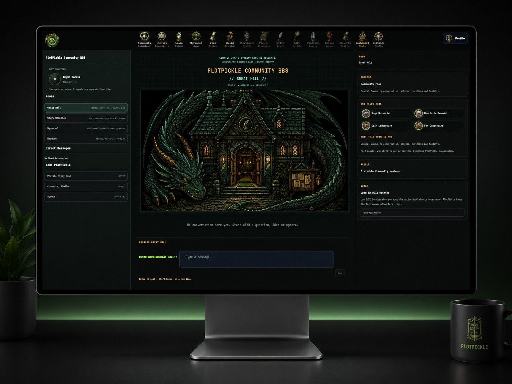
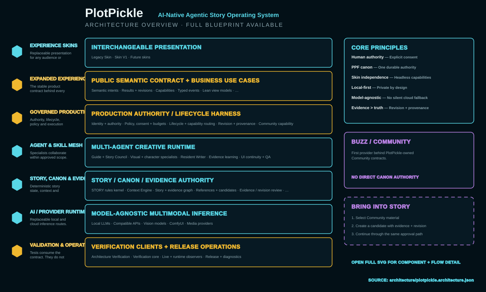

<p align="center">
  
</p>

<h1 align="center">PlotPickle</h1>

<p align="center"><strong>Learn the craft. Make the decisions. See the story take shape.</strong></p>

<p align="center">Local-first · Writer-controlled · Visual story shaping · AI optional · BUZZ-connected</p>

PlotPickle is a visual writing and creative-direction studio for people who want to shape a story from idea to screenplay to screen without giving away creative authority to an AI model.

It combines writing education, story planning, visual development, screenplay work, review, playable-story systems, local or cloud AI connections, Community/BUZZ collaboration, and a portable PlotPickle Project File (PPF) in one application.

**The Human remains the author.** AI can explain, suggest, draft, visualize and test ideas, but generated material does not silently become story canon.

## Core principle

> PlotPickle **product truth**:
>
> **Build a story or game through conversation.**\
> **Develop it by playing or watching it.**
>
> PlotPickle lets storytellers build through conversation. Agents translate approved intent into story structures, rules, and assets. The story and game engines bring that work into experiences people can play or watch, test, and revise through conversation.
>
> So the work ahead is to make that truth observable in the product.


## Vision: a creative operating system for Human–AI collaboration

> **A person brings imagination and purpose. PlotPickle connects that intention to capable collaborators, real work, trustworthy evidence and continuous learning.**

PlotPickle's ambition reaches beyond an AI-assisted screenplay or a collection of creative screens. We envision a **creative operating system** where Humans and AI agents work together to learn, design, write, make films, build playable worlds and improve the tools they depend on. This describes an operating environment for creative work, **not** a replacement for the computer's underlying operating system.

**The key distinction is that PlotPickle would not simply give an LLM more tools.** It would give the LLM a working environment with **continuity, evidence, responsibilities and the ability to turn decisions into verified results**. Instead of isolated instructions and disconnected outputs, authorized context carries forward, work is accountable, actions can be observed, and important outcomes can be independently checked.

An LLM can be more useful here than in an isolated chat. With the right permissions, it can understand the intended outcome, coordinate specialist capabilities, perform real actions, inspect their results, recover from ordinary failures and explain what remains uncertain. The Human should not have to translate every creative intention into a series of menus, prompts and disconnected technical steps.

**PlotPickle is not trying to remove Humans from creativity. It is trying to eliminate unnecessary friction between imagination and execution.** Human purpose, taste and judgment lead; the environment handles more of the coordination and mechanical work required to realize those choices. That begins to resemble **an operating system for Human and artificial intelligence working together**.

### Beyond storytelling: a foundation for many kinds of work

**Storytelling is PlotPickle's first proving ground, not the limit of its ambition.** Once the underlying architecture is reliable, its reusable capabilities—learning, context, agent orchestration, governed execution, independent verification and creative collaboration—need not be confined to screenplays or films.

The same foundation could support **interactive worlds, games, education, design, research, software development and other complex creative undertakings**. A learner might build and test a course; a designer might coordinate research, prototypes and reviews; a researcher might trace claims to evidence and reproduce findings; a developer might delegate a scoped software change through independent tests. These are examples of future domain experiences, **not claims of functionality already delivered**.

This calls for a **domain-extensible operating environment**, not a filmmaking application with more unrelated tabs. The foundational capabilities should be reusable; each domain brings its own tools, artifact types, specialists, evaluation methods and decision rights. A screenplay's PPF canon remains authoritative for its story, but it must not become a forced data model for education, scientific research or software repositories. Sharing an orchestration and evidence foundation does not mean pretending every field has the same rules.

**Build the common capabilities once. Let people and agents apply them to many disciplines, with domain-specific truth and Human authority preserved.** Film and playable stories provide demanding real-world tests of this architecture; success there should help PlotPickle expand responsibly into new kinds of work.

### From an idea to something you can experience

Imagine a creator arriving with an idea for a story about two estranged brothers. PlotPickle helps explore the premise, develop character motivations, learn relevant craft, write and revise the screenplay, build consistent visual references, plan cinematography, assemble shots and review an evolving film. The writing, character, directing, storyboard, editing and sound capabilities share **approved, versioned project context** instead of independently inventing what earlier collaborators decided.

The creator can pause to examine a scene, challenge a suggestion, make a new artistic choice or enter the precise workspace where a decision matters. **The Human remains the author and director; agents make skilled work easier to attempt, inspect and improve.**

The same environment can also help improve itself. If the storyboard workflow fails, an authorized Software Factory worker could reproduce the defect, inspect the code, prepare a fix in isolation, run focused tests and build checks, and request independent Windows/browser verification. A verified change becomes eligible for the applicable review and merge authority. If a production challenge reveals a missing filmmaking technique, the Learning & Evolution Factory could investigate professional references, evaluate an approach and propose a reusable lesson or agent Skill.

The developing **four-Factory ecosystem** joins **Software**, **Learning & Evolution**, **Story Builder** and **Game — STORY: The Unwritten**, coordinated for creative work by the **Semantic Story Coordinator**. Software repairs the tools; Learning improves the methods; Story Builder produces reviewable screen and sound assets; STORY governs playable experiences. None of these replaces the Human's accepted PPF canon. Evidence-backed handoffs let each contribute without silently promoting proposals or rewriting story history. This shared experience is **[Living Story Worlds](#living-story-worlds-the-shared-humanai-creative-experience)**; the detailed [roadmap](#roadmap-four-factories-and-one-semantic-story-coordinator) defines separate responsibilities and current delivery truth.

**How the Factory works as an organization:** [PlotPickle Organization Chart](PlotPickleOrganizationChart.md) maps the Owner, Factory Director, engineering foundation, three creative/product factories, specialist roles, independent QA, Release Management, and durable operating controls—then follows an issue from intake to verified delivery.

### Living Story Worlds: the shared Human–AI creative experience

**Living Story Worlds is not another Factory.** It is the unifying creative experience made possible by **four specialized Factories**—Software, Learning & Evolution, Story Builder, and Game—working with the **Semantic Story Coordinator** and the same governed project context. The Human and AI collaborate in an ongoing creative environment, not merely a prompt-and-output assembly line. This extends PlotPickle's existing learn → write → visualize → play direction; it does not replace Matrix, PPF, the seven-layer architecture or established creative authority.

A creator could develop an original story, watch an approved version of it, step inside a playable interpretation, change a character's decision and propose a new film from the consequences. The AI collaborator can notice continuity conflicts, ask substantive questions, offer directing alternatives, investigate craft and explain what changes downstream. Within Human-granted scope it can carry out routine planning and tests; **it does not silently accept creative proposals, rewrite canon, publish material, expand permissions or authorize spending**. Conversation, visual workspaces, play and production should all refer to the same versioned source and decision history.

Living Story Worlds grows through three complementary modes:

- **Reconstruct:** analyze an original, public-domain or properly licensed screenplay; preserve its intended narrative; and develop source-linked scene, shot, performance, location and sound plans for an authorized AI-assisted production.
- **Reimagine:** create a separately identified branch when a character makes another choice, a relationship changes or an alternate ending emerges. The Coordinator traces causal, thematic and production consequences rather than merely substituting dialogue.
- **Hybridize:** combine **rights-cleared** characters, worlds, rules, story elements or original contributions into a new film or interactive experience. Each contribution retains its provenance, permitted uses and revision lineage; different universes are never silently treated as interchangeable canon.

**One narrative authority, many possible experiences.** The selected, versioned PPF remains the accepted story-canon authority. Proposed branches have distinct identities and histories; they do not overwrite their parent or turn a played game session into canonical screenplay truth. The Semantic Story Coordinator reasons about character motivation, causality, lore, setup/payoff, continuity and audience knowledge across media. It separates **narrative truth** (what happens and why), **director intent** (how to express it on screen) and **render execution** (how an approved provider produces assets), so the project can change models or game implementations without losing its story.

The **Story Builder Factory** turns approved narrative and director specifications into reviewable visual and audio production: Hollywood-style script breakdown and colour-coded production annotations, consistent character and world references, shot plans, storyboard, Previs, keyframes, motion, dialogue/foley/music and timeline assembly. A **model-independent Character Identity Contract** owns character continuity; LoRAs, 3D rigs, reference images and voice assets are optional implementations, not the canonical identity. Media work proceeds in recoverable, source-addressed stages with observable costs, provider permissions, Save/Lock review and independent output checks—not an uncontrolled one-click promise of a finished 4K movie. The Game Factory reuses *authorized* world concepts through deterministic legal-move/state contracts; it does not move session outcomes into PPF canon without a separate admission.

**Rights & Provenance is a cross-cutting gate, not a fifth Factory.** Importing a screenplay for legitimate analysis is not the same as having the right to adapt, render, distribute or remix it. Original works, jurisdiction-specific public-domain material, licensed adaptations and mixed-source hybrids require different checks. Track screenplay and film rights, character/world derivation, music and recordings, performer likeness and voice permissions, intended use and uncertain restrictions before generation or sharing. A Hollywood screenplay's existence—or a hypothetical technically feasible remake—does **not** confer adaptation rights. Unknown permissions remain unresolved and cannot be waved through by an agent or by a proposed noncommercial use.

**Develop this incrementally.** First prove shared source-linked scene/shot contracts and Human–AI decision handoffs; next complete one approved mini-block through the existing Storyboard → Previs → Timeline flow; then validate a canon branch and a separately governed playable interpretation. Licensed multi-world hybrids come later. These are **target capabilities**, not claims that automatic screenplay-to-film rendering, cross-world remixing, persistent AI creative autonomy or a finished Game Factory is already shipped.

### Give agents meaningful freedom, not just more buttons

Our direction is to give capable agents **more room to work toward Human-defined objectives**. A user should be able to delegate an outcome—such as developing a sequence, validating a playable scene, diagnosing a broken workflow or completing a batch of approved engineering issues—rather than personally orchestrating every tool call.

That freedom should be **substantial within an explicit delegation**. An agent may investigate, plan, coordinate tools, execute authorized steps, test alternatives, react to failures and report progress without repeatedly seeking permission for routine actions already covered by the user's decision. PlotPickle should support evolving delegation scopes, chosen providers, resource limits, safety and privacy boundaries, stop controls and observable work receipts. Greater proven capability should make broader *Human-granted* delegation practical; an agent cannot expand its own permissions.

Creative canon changes, publishing or sharing private material, new paid spending permissions, installing unreviewed code and merges outside approved gates remain distinct decisions. The goal is **maximum useful agency with accountable authority**, not an agent that claims every power or interrupts the Human at every step.

### Build truth into every action

**Build truth rather than simply building screens.** This principle matters because more powerful agents need more than interfaces that appear to work: they need reliable state, preserved decisions, accountable execution and evidence that proves what happened. Visual workspaces should reveal that truth and help Humans act on it, rather than becoming the authority themselves.

A system that acts must distinguish four different things:

1. **Believed:** an agent's interpretation or hypothesis.
2. **Proposed:** a change, plan, lesson or creative option awaiting the appropriate decision.
3. **Executed:** an observable action with a source, owner and result.
4. **Independently verified:** a result checked by the relevant deterministic, product or Human acceptance authority.

Passing a unit test is not proof that a Windows interface works. A running tunnel is not proof that a remote plugin authenticated. A generated scene is not approved screenplay canon. PlotPickle must make those distinctions visible, preserve provenance and allow correction when evidence contradicts an agent's expectations.

**Learning and evolution are practical, evidence-driven loops.** Research, production outcomes, playtests, evaluations and verified repairs may improve approved lessons, Skills, workflows and agent references. This does not mean an LLM silently retrains its model weights or that unreviewed findings become authoritative.

### The destination

Over time, people should spend less energy explaining how PlotPickle operates and more energy imagining what they want to create. AI agents should gain more durable context, useful tools, authorized initiative and feedback from the real world; the software should become easier to use and better equipped for the next project.

**Arrive with an idea. Create something meaningful. Leave both the work and the tools better than you found them.**

This is a direction for development, not a claim that fully autonomous production, self-repair, self-improvement or unrestricted agent operation has shipped. We will earn that freedom through working capabilities, demonstrated results and Human trust.

## Why PlotPickle is evolving: from screens to intent

PlotPickle's visual workspaces grew as its storytelling, film-production, learning and game capabilities expanded. They are valuable when a Human wants to write dialogue, inspect a character, compare storyboard frames, edit a timeline or play a game. But requiring people to find and coordinate an ever-growing sequence of menus and screens before work can happen is no longer the right default. AI agents also should not have to imitate mouse clicks to perform operations the application already understands.

**The direction is intent-centred software, not a chat-only replacement for the GUI.** A creator expresses the outcome they want; PlotPickle identifies the selected project, context, relevant capabilities and permitted agents, prepares source-linked evidence and alternatives, and opens the appropriate visual workspace *when it adds value*. Human decisions remain authoritative. This is the practical meaning of **"stop programming screens and start programming truth."**

The shared interaction has three stages, with **different questions and different authority for each responsibility**:

| Responsibility | Intent: what should happen? | Evidence: what is actually known or prepared? | Decision: whose authority is required? |
|---|---|---|---|
| **Software Factory** | What needs to be built, tested or repaired? | Reproduction, source diff, exact-commit CI and real Windows/browser results. | Scope, exceptions, stop or a merge not already covered by explicit green-only authorization. |
| **Learning & Evolution Factory** | What should PlotPickle learn, teach or become capable of? | Vetted craft references, research, rights, evaluations and practical teaching candidates. | Publish or revise a lesson/Skill, adopt an integration, commission improvement or defer. |
| **Story Builder Factory** | How should an approved story or branch become a reviewable film or sound experience? | Source-linked script breakdown, scene/shot intent, identity/continuity references, provider plans, cost and output receipts. | Accept visual/audio revisions and production checkpoints; separately authorize paid renders, identity/voice use, publication and rights-constrained adaptations. |
| **Game Factory — STORY: The Unwritten** | What world, game, character, encounter or experience should be created or played? | Valid rules, legal actions, knowledge boundaries, deterministic consequences, session replay and actual playtest findings. | The player's meaningful in-game choice; separately, the creator's approval for new rules/worlds or game publication. |
| **Semantic Story Coordinator** | What should change or improve in this story or film? | Selected, versioned PPF source, semantic and continuity findings, production impact and alternatives. | The author's acceptance, rejection or revision of creative proposals, assets or canonical changes. |

A decision prompt appears **only when the relevant authority is actually needed**. A legal player move may resolve under accepted game rules; a previously authorized engineering change may merge after independent required gates. Neither grants permission to modify story canon, install software, publish lessons or spend on a provider. The system must distinguish **verified observations, reproducible defects, research candidates, creative suggestions, insufficient evidence and blockers** rather than inventing a single "AI success" state.

**One capability, several interfaces.** Chat, voice, GUI, CMD and agent-native/headless tools should invoke the same versioned, governed operations. PPF remains the durable story-canon authority; STORY owns deterministic game-session transitions; GitHub and independent verification govern code; and editorial/source review governs teaching and research adoption. The existing lifecycle, agent Skills, project revisions and provider permissions must not be reimplemented in a parallel "intent engine". AG-UI, MCP and generative UI may help transport capabilities and present live evidence, but protocols are implementation choices, not proof of behavior or authorization.

For example, "Review Brotherly Love Sequence 1 and suggest the next production steps" should produce source-bound findings, affected story/shot addresses, alternative remedies and direct entry into the right editor without requiring manual navigation through every stage. A valid game-world adaptation can then be proposed to The Unwritten; a missing craft lesson can become a Learning & Evolution candidate; a reproducible saved-image defect goes to the Software Factory. No handoff silently promotes creative proposals, game outcomes or research findings into authoritative state.

This is a **product evolution plan**, not a claim that unified conversational routing, a complete game creator, automatic semantic improvement or unattended software engineering is already shipped. Preserve the current Matrix workspaces and the [locked Product Contract](docs/PLOTPICKLE-PRODUCT-CONTRACT.md) during migration; any incompatible shell change requires a documented, Human-approved contract change. Track the intended interaction and evidence contract in [#3203](https://github.com/BryanHarrisScripts/PlotPickle/issues/3203), alongside [STORY #1675](https://github.com/BryanHarrisScripts/PlotPickle/issues/1675).

## Current availability

PlotPickle is in active pre-release development. A public Windows installer is not currently available; release and download instructions will be added when there is a real build for users to install.

Developers can run the repository from source using the instructions below. There is no required paid AI provider and no silent local-to-paid-cloud fallback.

## What PlotPickle does

The current user-facing shell is **Matrix**. Its Dashboard groups work under **Explore, Develop, Visualize, Review, Pitch, Play and System**, while the underlying story, canon and evidence contracts remain shared across those surfaces.

### Learn

PlotPickle includes an 81-lesson writing curriculum. LEARN teaches the craft in the same application where you apply it, with Sage Brinewick available as a curriculum-grounded guide.

### Outline and planning

Planning turns learning and story ideas into explicit, reviewable decisions. Answers stay provisional until the writer accepts them.

### Visualize and production

Matrix connects approved story decisions to the current visual-development and production surfaces:

**Story → Outline → Storyboard → Previs → Timeline → Production**

### Storyboard, Previs and Render Plan

PlotPickle uses a predictable feature-film scaffold without forcing the writer to think in API calls or frame math:

**24 Story Blocks → 96 Mini-Blocks → 2,400 technical 3-second render clips**

Each 5-minute Block contains four 75-second Mini-Blocks. Each Mini-Block maps to 25 fixed 3-second generation slots when it reaches Render Plan.

Storyboard and Previs remain creative tools. The render grid is production plumbing: a nine-second creative camera move can span three technical clips while remaining one creative intention.

That gives every generated clip a stable address and allows surgical regeneration instead of rebuilding an entire scene because one three-second result failed.

### Write and Edit

Writing and editing remain connected to the same story structure and project. PlotPickle can work with screenplay-oriented material while preserving story, scene and Block context.

### Feedback and Refine

Feedback is anchored to stable story targets. Human review, diagnostics and optional AI proposals can be compared without automatically changing canon. Refinement remains an explicit Human decision.

### PlotPickle Score

When a story is loaded, PlotPickle can calculate a **PlotPickle Score**: a deterministic 0–100 structural rating backed by five transparent dimensions — **Alignment, Verbosity, Erosion, Progression and Coverage**.

The headline formula uses a geometric mean:

`Score = 100 × fifthRoot(Alignment × (1 − Verbosity) × (1 − Erosion) × Progression × Coverage)`

The score does not ask whether a story was written by a Human or AI. Human-written, AI-assisted, AI-generated and imported stories use the same structural evidence contract. Too little evidence produces **NR / Not Rated** rather than a fabricated quality number.

PlotPickle's mathematical narrative model converts normalized story time into stable addresses:

**runtime → 12 sequences → 24 Story Blocks → 96 Mini-Blocks → production/timecode coordinates**

For a default 120-minute feature, the canonical coordinates correspond to 5-minute Blocks and 75-second Mini-Blocks. These are **normalized structural addresses, not creative handcuffs**: scenes and shots may span, compress or cross those regions as the story requires.

This makes structural feedback locatable. Rather than only saying “the middle feels slow,” PlotPickle can identify which Blocks/Mini-Blocks have low progression, repeated evidence, unusual narrative load or missing coverage.

> **PlotPickle does for narrative structure what timecode does for film: it gives creative material a precise address.**

The mathematics provide the coordinate and measurement layer; they do not replace Human creative judgment. The full contracts are documented in [PlotPickle Score](docs/architecture/PLOTPICKLE-SCORE.md) and the [PlotPickle Mathematical Narrative Model](docs/architecture/PLOTPICKLE-MATHEMATICAL-MODEL.md).

The 24/96 coordinate system, PPF integration, technical render addressing, and PlotPickle Score application are documented as **PlotPickle-specific design by Bryan Harris**. Standard mathematics, screenplay structure traditions, timecode, sequence/beat methods and editing metrics remain acknowledged as established prior practice.

### STORY: The Unwritten

STORY: The Unwritten is PlotPickle's reusable playable-story engine. Its purpose is to let creators build stories that can be played, changed and eventually populated by bounded AI characters without creating a second PlotPickle authority system underneath the game.

The current engine foundation is headless and deterministic. It can run a five-scene story, validate player actions, resolve creator rules and consequences, handle victory/loss/endings, save and resume sessions, preserve accepted event history and checkpoints, persist sparse character state/memory/relationships, store admitted Story Pieces with provenance, protect knowledge partitions, hydrate only the active scene working set, and route selected completed-session outcomes through the existing PPF canon proposal boundary.

The governing rule is simple: **AI may propose or interpret; deterministic STORY code decides mechanical state changes.** Generated material does not become accepted session state or durable PPF canon merely because a model produced it.

STORY also keeps world scale separate from inference scale: **stored is not loaded; loaded is not active; active is not running inference.** A large world therefore does not imply that every character becomes a live agent or enters memory at once.

The dedicated creator controls, Game Validator, bounded AI-character execution and first-class STORY workspace are still in active development. The README describes those as upcoming work rather than presenting them as shipped UI.

Wyrmwood remains PlotPickle's first-party teaching game and proving ground. STORY is the reusable engine beneath future playable-story experiences; Wyrmwood is not being rewritten first. BUZZ remains the social/discovery layer and may launch STORY sessions later, but BUZZ does not own authoritative game state. PPF remains the durable canon authority.

## Community, BBS and BUZZ

### Community and BUZZ

<p align="center">
  
</p>

PlotPickle Community uses BUZZ for signed rooms, Communities, membership, presence and conversation.

PlotPickle does **not** automatically upload your screenplay, PPF, local files, prompts, credentials or private story work. Sharing into a Community is an explicit action.

## PlotPickle Nodes, Human profiles, Stewards and BUZZ

A PlotPickle Node is one installation/device. Human profile identity, Node identity and Agent/Steward identity remain separate so Community membership never grants access to another person's local files, models, GPU or services.

BUZZ carries signed Community conversation, membership and presence. The PPF remains the creative authority, and optional remote compute is a separately configured service boundary rather than peer compute from Community members.

## AI: use it, bring your own, or do not use it

Settings separates the important questions:

1. **What capability do you need?** Writing/reasoning, images, video or tools.
2. **Where should it run?** This computer, a private server or cloud.
3. **How should PlotPickle connect?** Local runtime, provider API, OpenAI-compatible API or another supported connection.
4. **Which provider/model should perform the work?**

Local text/model runtimes can include Ollama, LM Studio, llama.cpp and other OpenAI-compatible endpoints. Local image/video workflows can use ComfyUI. Optional cloud/BYOK providers remain separately configured and require the existing consent boundaries for paid work.

## One story authority

The PPF is PlotPickle's canonical creative record.

That means:

- the writer owns final creative decisions;
- AI output is proposal material until accepted;
- Storyboard and Previs cannot silently rewrite upstream story canon;
- STORY session state is not a second canon store;
- completed STORY outcomes can propose canon changes, but only the existing PPF admission path can make them durable canon;
- BUZZ conversation does not become canon automatically;
- deterministic tests remain product-quality evidence, not creative authority.

## Roadmap: four Factories and one Semantic Story Coordinator

For the traditional management/reporting hierarchy, departmental responsibilities, authority gates, real work-order flow and two-cycle autonomous Factory acceptance criteria, see **[PlotPickle Organization Chart](PlotPickleOrganizationChart.md)**. This operating guide supplements the roadmap without creating additional runtimes or changing accepted Human/PPF authority.

**North star:** PlotPickle helps people learn storytelling, shape meaningful stories, make visual films and build playable worlds, while improving its own tools and teaching. The long-term experience is intent-centred: **the Human defines purpose and retains meaningful authority; the system coordinates actual work and provides inspectable evidence.** This is a development roadmap, not a claim of unattended production, autonomous software repair, automatic story improvement or a completed creator-facing game factory.

The vision now names **four distinct Factories and one Semantic Story Coordinator**. Story Builder formalizes the governed story-to-screen production responsibility already present in PlotPickle; it is a target operating boundary, not a claim of a fully autonomous production system. All four Factories reuse the existing project, lifecycle, Skills, evidence and experience foundations rather than introducing another story database or authority:

1. **Software Factory — build, test and repair PlotPickle.** A governed coding worker (ChatGPT-mediated or an explicitly approved local Pi/other worker), real reproducible issues, isolated source changes, focused tests and builds, independent exact-commit CI and Windows/browser acceptance lead to reviewable PRs and explicitly authorized green-only merges. A persistent queue and Chat/GUI/CMD status should progress the next eligible task without copying logs. Neither a model's claim of success nor a passing synthetic contract replaces verified source and real product evidence; unavailable host/agent capacity stays blocked, not fictionalized.
2. **Learning & Evolution Factory — expand human and system capabilities.** [OSS RADAR](.github/workflows/oss-radar.yml) and its [creative learning companion](docs/developer-briefs/oss-radar-creative-top-three.md) join vetted craft research, professional screenplay and Hollywood terminology, story/character/world development, directing, cinematography, lighting, blocking, editing, sound, interactive learning, accessible UX, reusable Skills, AI/media tools and infrastructure. Evidence-backed candidates can lead to Human-reviewed lessons, exercises, glossaries, contextual help, evaluated agent references, product improvements or justified OSS integrations. Research does **not** authorize automatic lesson alteration, package execution, installation or merge.
3. **Story Builder Factory — turn approved narrative intent into film and sound.** The existing Outline → Storyboard → Previs → Timeline pipeline evolves into a governed production studio: Hollywood-style script and colour breakdown, source-addressed director shot specifications, model-independent character/world identity, storyboard and camera/lighting plans, keyframes, video/audio synthesis, and editable timeline/FFmpeg or interchange exports. Provider-dependent LoRAs, reference guides and neural renderers remain replaceable implementation choices. A staged render needs source/provenance checks, cost visibility, explicit provider and rights permissions, Human review, recoverable evidence and separate Save/Lock decisions. A planned capability or technical rendering slot is not proof that a complete movie has been produced.
4. **Game Factory — STORY: The Unwritten.** [STORY's reusable engine](docs/story-the-unwritten.md) enables creators and players to assemble Story Pieces, worlds, rules and scoped AI characters into playable, replayable experiences. STORY's deterministic resolution kernel—not an LLM—decides legal moves, costs, consequences and session state. Its [roadmap #1675](https://github.com/BryanHarrisScripts/PlotPickle/issues/1675) covers creator-facing tools, Game Validator, bounded AI characters, playtesting and safe world sharing. Wyrmwood remains the existing learning game, BUZZ remains discovery/community, and PPF remains accepted story canon. **Game play and game creation are different authority paths:** a player's legal move is not automatic permission to change world rules or promote a session outcome into a screenplay.
5. **Semantic Story Coordinator — help actual stories evolve with understanding.** Against the explicitly selected, versioned PPF project (including **Afterglow Version 9** and **Brotherly Love**), assess source-linked meaning and production: character motivation, causal logic, setup/payoff, emotional/thematic coherence, continuity, audience knowledge, scene/shot intent, filmability and Storyboard/Previs/Timeline consistency. Explain *what may be missing, where, why it matters, how a craft principle applies and alternative remedies*; link to lessons and preview affected production assets. Distinguish a verified contradiction, creative suggestion, insufficient evidence and a genuine software defect. Creative proposals stay noncanonical until accepted; no silent screenplay rewrite, Save/Lock, cross-project mutation or paid generation. Reproducible software defects return to the Software Factory with sanitized Semantic UAT evidence.

**One connected but governed loop:** the Coordinator understands the selected story and its proposed branches; the Story Builder Factory executes authorized screen and sound production; the Game Factory resolves authorized playable rules; Learning improves the methods; and Software repairs reproducible platform defects. Production or playtest results can inform creative proposals, research or sanitized UAT reports. **The Coordinator owns semantic interpretation and proposals; Story Builder owns media-production execution; PPF alone governs accepted story canon.** Each handoff carries source, rights/provenance, authority, cost/evidence and verification state. Human judgment determines creative acceptance; deterministic legality and structural completeness remain narrower claims. **Living Story Worlds connects these responsibilities as one experience; it is not a fifth Factory.**

### Delivery order and evidence

| Stage | Intended milestone | Current truth |
|---|---|---|
| 1. Prove local coding | Verify the real Windows Pi model makes an authorized source edit and produces a bounded patch, not just a text answer. | [#3159](https://github.com/BryanHarrisScripts/PlotPickle/issues/3159) remains open. A hosted-Windows **mock-model** write-tool test passed in [PR #3184](https://github.com/BryanHarrisScripts/PlotPickle/pull/3184), but that does not prove the owner's local model. |
| 2. Prove the repair cycle | Genuine Windows Semantic UAT defect → bounded agent fix → independent build/GUI retest → PR → authorized merge → next task, with clear Stop/Status controls. | [#3110](https://github.com/BryanHarrisScripts/PlotPickle/issues/3110), [#3128](https://github.com/BryanHarrisScripts/PlotPickle/issues/3128), [#3142](https://github.com/BryanHarrisScripts/PlotPickle/issues/3142). Not yet proven end-to-end. |
| 3. Work through the existing backlog | Process the finite, eligible GitHub issues with scope, dependencies, receipts and green-only merges; block rather than invent success. | [#3148](https://github.com/BryanHarrisScripts/PlotPickle/issues/3148). Completion remains to be demonstrated. |
| 4. Evolve learning and filmmaking | Qualify OSS RADAR discoveries into approved teaching, Skills, UX, creative-production and infrastructure improvements; test usefulness and regressions. | Roadmap; no automatic intake yet. |
| 5. Coordinate living story worlds | Explain source-backed semantic gaps and alternatives in Brotherly Love and Afterglow, establish approved branch identity/lineage and propagate only accepted PPF revisions through production. | Extend [Brotherly Love #3004](https://github.com/BryanHarrisScripts/PlotPickle/issues/3004) and [Afterglow #2947](https://github.com/BryanHarrisScripts/PlotPickle/issues/2947). Cross-media branching is a target; current canon authority is unchanged. |
| 6. Prove the Story Builder Factory | Complete one approved mini-block through source-linked scene/shot contracts, consistent visual references, storyboard, Previs, motion/audio review and timeline output with measured render cost and recoverability. | Existing production surfaces and technical clip addressing are the baseline; end-to-end automatic screenplay-to-movie production is not yet independently demonstrated. |
| 7. Grow the playable Game Factory | Build/validate/story-play a genuine The Unwritten five-scene vertical slice, then govern creator rules, bounded characters and UX. | [#1675](https://github.com/BryanHarrisScripts/PlotPickle/issues/1675) is on hold. Existing headless rules, replay and persistence are foundations, **not** a shipped complete game creator. |

The intent-centred product transition is tracked in [#3203](https://github.com/BryanHarrisScripts/PlotPickle/issues/3203); the engineering Factory is tracked in [#3110](https://github.com/BryanHarrisScripts/PlotPickle/issues/3110); the Game Factory remains governed by [#1675](https://github.com/BryanHarrisScripts/PlotPickle/issues/1675). **Simple outside, modular inside:** creators should encounter meaningful evidence, decisions, lessons, editable workspaces and playable results—not a second toolchain, duplicate story database or unexplained machine verdict.

<!-- PLOTPICKLE:UPDATES:START -->
## UPDATES

Current living architecture: **v1.0 · TARGET · source updated 2026-09-12**  
Fingerprint: `sha256:92ad6f9591530ef3b5fb161edb5051f92d624f83da8c3d939f8d038ea9efee9c`

- Architecture status: **TARGET** — 7 canonical layers from one machine-readable map.
- Documentation freshness: **CURRENT generated surfaces; Human architecture prose remains REVIEW-owned**.
- Agent Context: **CURRENT**.
- C4 freshness: **CURRENT**.
- Current map summary: Community entry + monochrome presentation merged. Full Community contracts, versioned Skin adapters and Bring into Story remain migration work.

Inspect the living evidence: [Architecture Knowledge Map](architecture/plotpickle.architecture.json) · [Architecture Documentation](architecture/README.md) · [Documentation Drift Detection](docs/updates/documentation-drift.md) · [Agent Context](docs/architecture/agent-context.md) · [C4 Diagrams](architecture/plotpickle-c4.md).

Previous current entries are preserved in [UPDATES history](docs/updates/README.md), not accumulated in this README.
<!-- PLOTPICKLE:UPDATES:END -->

<!-- PLOTPICKLE:ARCHITECTURE:START -->
## ARCHITECTURE

PlotPickle's architecture is generated from one machine-readable source: [`architecture/plotpickle.architecture.json`](architecture/plotpickle.architecture.json). The application Skins do not own this documentation style; architecture diagrams use their own dedicated Architecture Skin.

The README intentionally shows a compact overview. **[Open the full-resolution Architecture Blueprint](architecture/plotpickle-architecture.svg)** for component-level detail, authority boundaries and flows.

<p align="center">
  
</p>

| Layer | Boundary | Responsibility |
|---:|---|---|
| 1 | EXPERIENCE SKINS | Replaceable presentation for any audience or device. |
| 2 | EXPANDED EXPERIENCE LAYER | The stable product contract behind every Skin. |
| 3 | GOVERNED PRODUCTION ORCHESTRATION | Authority, lifecycle, policy and execution control. |
| 4 | AGENT & SKILL MESH | Specialists collaborate within approved scope. |
| 5 | STORY, CANON & EVIDENCE CORE | Deterministic story state, context and durable canon. |
| 6 | AI / PROVIDER RUNTIME | Replaceable local and cloud inference routes. |
| 7 | VALIDATION & OPERATIONS | Tests consume the contract. They do not run the product. |

BUZZ is the first provider behind PlotPickle-owned Community contracts. Community material has no direct canon authority. The governed bridge remains: **Community material → Bring into Story → Candidate → Evidence / Revision → Human approval → PPF Canon**.

To regenerate both diagrams and this managed section after an architecture change, run `node architecture/generate-architecture.mjs`. CI runs `node architecture/generate-architecture.mjs --check` so the JSON source, full blueprint, README overview and managed README section cannot silently drift apart.
<!-- PLOTPICKLE:ARCHITECTURE:END -->

## The default feature-film production model

| Layer | Plain-English meaning | Default duration | Count |
|---|---|---:|---:|
| Feature | Complete default movie scaffold | 120 minutes | 1 |
| Story Block | Major story chapter | 5 minutes | 24 |
| Mini-Block | Controlled story/visual sequence | 75 seconds | 96 |
| Render clip | Technical generation slot | 3 seconds | 2,400 |
| Shared clip boundary | Start/end continuity anchor | — | 2,401 |

The 2,400 clip slots are deterministic addresses, not 2,400 records that must be generated up front. PlotPickle derives the grid and persists real production work as the Human plans or generates it.

## Keyboard navigation

PlotPickle supports single-letter workspace navigation when focus is not inside an input, editor, control or dialog.

The interface intentionally does not print those letters under every navigation icon. Open **Settings → Help → Keyboard navigation** for the current command map.

## Data and privacy

PlotPickle is local-first.

Projects and profile-owned data remain on the user's machine unless the Human deliberately invokes an external provider, backup/sync feature or Community share.

Credentials do not belong in PPF story files. Community presence does not make another person's computer available as compute. Optional remote compute is a separately configured service boundary.

## Optional companions

PlotPickle can connect to optional services, including:

- **BUZZ** for Community, signed rooms and presence;
- **Ollama / LM Studio / llama.cpp** for local writing models;
- **whisper.cpp** for optional local speech-to-text and dictation;
- **ComfyUI** for local image/video workflows;
- configured cloud/BYOK providers for capabilities the user explicitly chooses.

Core PlotPickle should still open and remain useful when those optional services are unavailable.

<!-- PLOTPICKLE:OSS:START -->
## Built with open source

PlotPickle is an open-source project built on, connected to, developed with, and materially informed by a wider open-source ecosystem. We want both the software and the ideas that genuinely contributed to the current product to remain visible.

The canonical machine-readable inventory is [`config/third-party-oss.json`](config/third-party-oss.json). It records how each system is used, its upstream source, licence evidence, pinned/user-managed version status, current evidence paths and any retained notice. `package.json` and `package-lock.json` remain the authoritative complete npm dependency graph, including transitive packages; the public-readiness audit checks that graph against this registry.

| Open-source system | How it contributes to PlotPickle | Licence |
|---|---|---|
| Node.js | Pinned runtime used by PlotPickle and Windows packaging work | MIT, plus upstream third-party notices |
| React | Primary UI runtime | MIT |
| Vite | Build/local application runtime | MIT |
| Vinext | Next-compatible application runtime | MIT |
| Tailwind CSS | CSS/tooling dependency in the application stack | MIT |
| Mastra | Bounded agent/orchestration runtime | Apache-2.0 |
| Vercel AI SDK | Provider-neutral AI runtime primitives | Apache-2.0 |
| Drizzle ORM | Data/database tooling | Apache-2.0 |
| libsodium / libsodium-wrappers-sumo | Authentication/profile cryptography | ISC |
| JetBrains Mono | Self-hosted canonical monospace UI typeface | OFL-1.1 |
| BUZZ | Optional Community, signed rooms and presence | Apache-2.0 |
| Ollama | Optional user-managed local model runtime | MIT |
| llama.cpp | Optional user-managed local model runtime | MIT |
| whisper.cpp | Optional reviewed local speech-to-text runtime | MIT |
| ComfyUI | Optional user-managed local image/video workflow runtime | GPL-3.0 |
| FFmpeg / ffprobe | Optional user-managed local media measurement for Sequence Evidence; not bundled | LGPL-2.1-or-later by default; some builds are GPL-2.0-or-later |
| Lazy Frames | Optional reviewed local animatic tool | MIT |
| Portless | Developer endpoint/runtime tooling | Apache-2.0 |
| Pi coding agent | Optional external developer/repair worker | MIT |
| Pi Durable | Managed durable execution and recovery adapter; DSDD and host authority remain authoritative | MIT |
| Cline | Optional external developer/repair worker | Apache-2.0 |

### Open-source ideas and workflows we adapted

These projects are not presented as PlotPickle runtime dependencies. They are acknowledged because their current OSS work materially informed a PlotPickle methodology, architecture decision or reviewed workflow. PlotPickle keeps explicit evidence markers in the current architecture documents so this list cannot silently drift.

| Open-source reference | How it informed current PlotPickle | Licence |
|---|---|---|
| ReelBench Skills | Inspired the Sequence Evidence split between machine-measured facts, bounded model annotation and deterministic validation | Apache-2.0 |
| BERD | Architectural reference for managed sidecars, pinned runtimes, lifecycle checks and validation patterns | Apache-2.0 |
| GitHub Spec Kit | Reference for PlotPickle's repository-native spec-driven development discipline and post-build convergence check | MIT |
| Lightricks ComfyUI-LTXVideo pinned workflow | Source/reference for the reviewed single-stage LTX proof graph at the recorded upstream revision | Apache-2.0 at the pinned source revision |
| ComfyUI LTX-Video workflow template | Reference for the reviewed text-to-video LTX graph adaptation | MIT |
| Sideshow | Inspired the shared visual Review Stage pattern for inspecting bounded agent work and attaching Human feedback to exact review items | MIT |
| Color Expert Agent Skill | Reviewed knowledge/methodology source for PlotPickle's independently authored Color Expert adapter Skill | CC BY 4.0 for upstream original project materials; source-derived references retain their original terms |

Evaluation-only or future candidates are deliberately **not** presented as contributors merely because they appear in an issue or architecture discussion. They enter this acknowledgement only when their work materially influences current PlotPickle and the same change adds an auditable `PLOTPICKLE:OSS-INFLUENCE:<registry-id>` declaration.

PlotPickle also supports reviewed third-party model/assets under their own terms. For example, the optional SDXL Base 1.0 starter is pinned and verified under its OpenRAIL++ terms, and the optional whisper.cpp `base.en` speech model is pinned to an immutable reviewed revision under its recorded MIT terms. A connection being supported does **not** mean it is open source: LM Studio and configured proprietary/cloud/BYOK providers are deliberately excluded from the OSS tables rather than being mislabelled.

For licence scope and retained notices, see [`LICENSES.md`](LICENSES.md), [`NOTICE.md`](NOTICE.md), the full npm lockfile and the paths recorded in the canonical registry. Third-party names and trademarks belong to their respective owners; acknowledgement does not imply endorsement or sponsorship.
<!-- PLOTPICKLE:OSS:END -->

## Run from source

Until a public Windows installer is released, the repository is the developer-facing way to run PlotPickle.

### Requirements

- Node.js **22.13 or newer**;
- Git;
- a supported desktop browser for development.

### Development

```bash
git clone https://github.com/BryanHarrisScripts/PlotPickle.git
cd PlotPickle
npm ci
npm run dev:local
```

### PlotPickle Development Loop

Non-trivial product and architecture work follows the repository-native loop:

**IDEA → ASSESS → DEVELOPER BRIEF → ISSUE → PLAN → BUILD → TEST/FIX → CONVERGE → PR GATES → MERGE**

`AGENTS.md` is the project constitution. Convergence checks that the finished diff and evidence satisfy the promised acceptance criteria; PR Gate and Product Gate then independently prove the tested head is healthy. See [`docs/architecture/PLOTPICKLE-DEVELOPMENT-LOOP.md`](docs/architecture/PLOTPICKLE-DEVELOPMENT-LOOP.md).

### Production verification

```bash
npm test
npm run build
```

### Windows packaging development

```bash
npm run package:windows
```

Windows packaging remains development/release-engineering work. This command and its CI coverage do not represent a currently available public installer.

## Repository map

- `app/` — product screens, application shell and UI runtime
- `core/` — canonical contracts, project authority and core storage/security boundaries
- `modules/` — product-domain implementations such as LEARN, PLAN, BUILD, Wyrmwood and STORY: The Unwritten
- `lib/` — shared domain/runtime capabilities
- `learn/` — curriculum content
- `tests/` — deterministic product and architecture contracts
- `docs/` — architecture, developer briefs, audits and historical design material
- `scripts/` — developer, verification and packaging tooling

## Documentation

Useful starting points:

- [Writing and Production](public/docs/readme/WRITING-AND-PRODUCTION.md)
- [PlotPickle Product Contract](docs/PLOTPICKLE-PRODUCT-CONTRACT.md)
- [PlotPickle Score](docs/architecture/PLOTPICKLE-SCORE.md)
- [PlotPickle Mathematical Narrative Model](docs/architecture/PLOTPICKLE-MATHEMATICAL-MODEL.md)
- [STORY: The Unwritten architecture](docs/story-the-unwritten.md)
- [Structure Engine](docs/architecture/structure-engine.md)
- [Authentication threat model](docs/architecture/PLOTPICKLE-AUTH-THREAT-MODEL.md)
- [Developer documentation](docs/developer/)

## Project status

PlotPickle is actively developed and remains pre-release. The current Matrix experience is being converged and validated across its governed surfaces while Windows distribution packaging is still being completed. STORY: The Unwritten has its deterministic rules kernel and sparse persistence/canon foundation in place; creator controls, validation, bounded character agents and the dedicated playable workspace remain active development work.

The product direction is to retain and verify Matrix while gradually moving from compulsory screen-by-screen navigation to governed intent, source-linked evidence and decision-specific visual workspaces. This is a planned migration under existing Human authority and locked UX contracts, not an already completed agent-native experience. Windows external testing still requires a real installable release.

Issues and pull requests are tracked in this repository. If you find a confusing workflow, visual inconsistency, failed install, lost navigation path or reproducible bug, please capture the steps and environment so it can become a deterministic product fix.

## License

PlotPickle is licensed under **AGPL-3.0-or-later**. See [LICENSE](LICENSE).